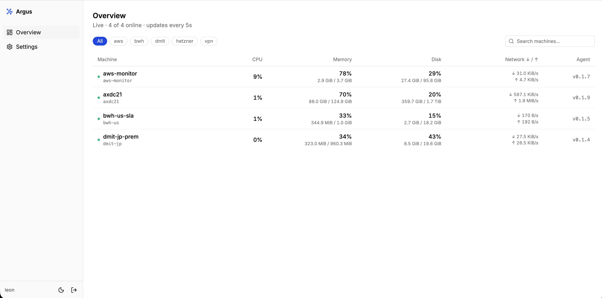
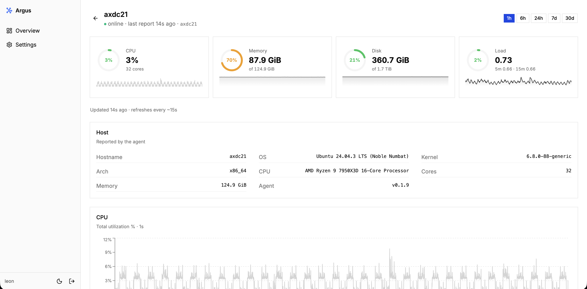
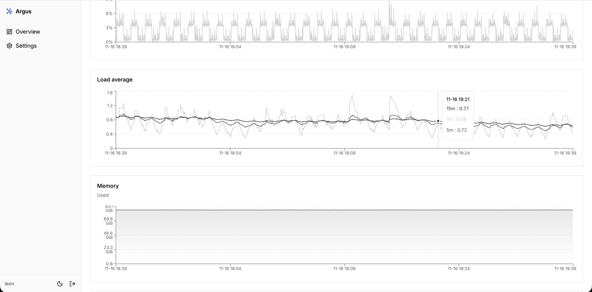
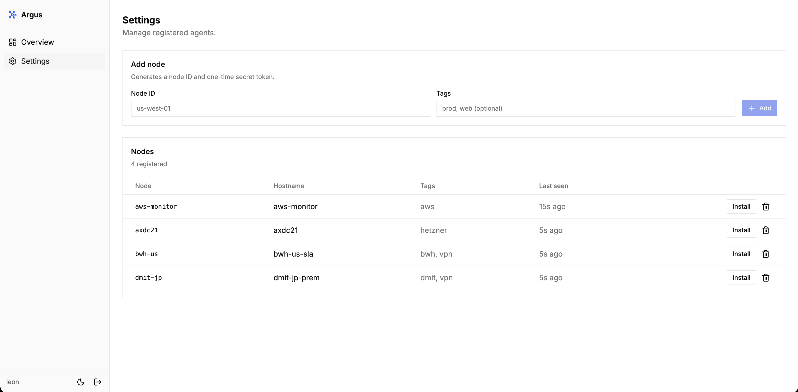

# argus

Lightweight server monitoring built with Go and React. The server and agent are
standalone Go binaries; the dashboard is a separately deployed web app.

## 界面预览

| 总览 | 实例详情 |
| --- | --- |
|  |  |

| 历史图表 | 节点管理 |
| --- | --- |
|  |  |

## 配置

每个组件各带一份提交进仓库的配置示例，字段含义见文件内注释：

| 组件 | 示例 |
| --- | --- |
| argus-server | [server/config.example.yaml](server/config.example.yaml) |
| argus-agent | [agent/config.example.yaml](agent/config.example.yaml) |

本地开发直接运行 `make run-server`：缺少 `server/config.local.yaml` 时会从示例
自动复制（该文件与本地数据库均已被 `.gitignore` 忽略）。生产环境的配置位置与
绝对路径要求见[安装指南](docs/install.md)。

首次启动时数据库里没有管理员，打开 Web 界面会进入初始化页创建账号（也可用
`ARGUS_ADMIN_USERNAME` / `ARGUS_ADMIN_PASSWORD` 在启动时播种）。

## Docs

- [安装指南](docs/install.md) — 安装 server 与 agent、配置与安全模型
- [本地开发](docs/local-dev.md) — MacBook 本地跑 server + 前端，远程主机主动上报
- [构建与发版](docs/build.md) — 项目结构、本地构建与发版流程
- [指标字典](docs/metrics.md) — 每个采集指标的含义与语义
